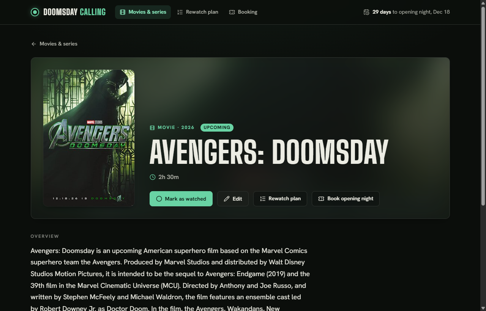
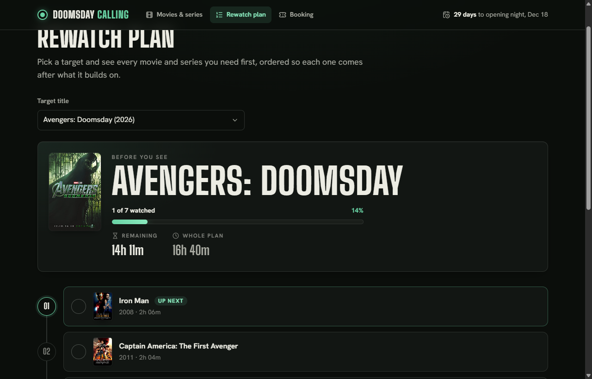
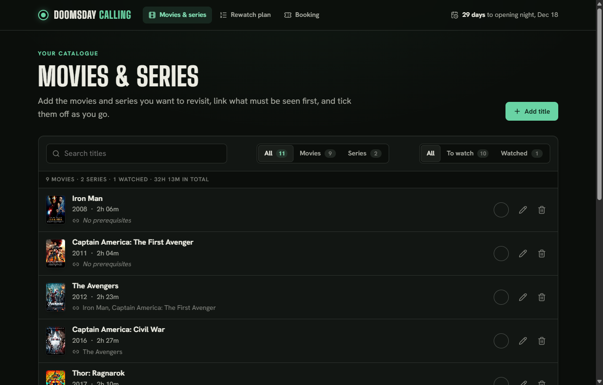
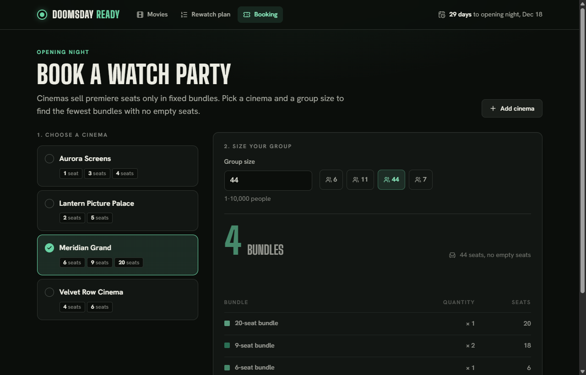
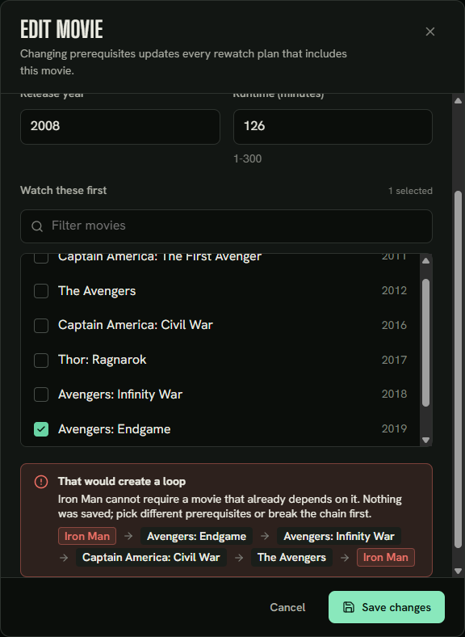
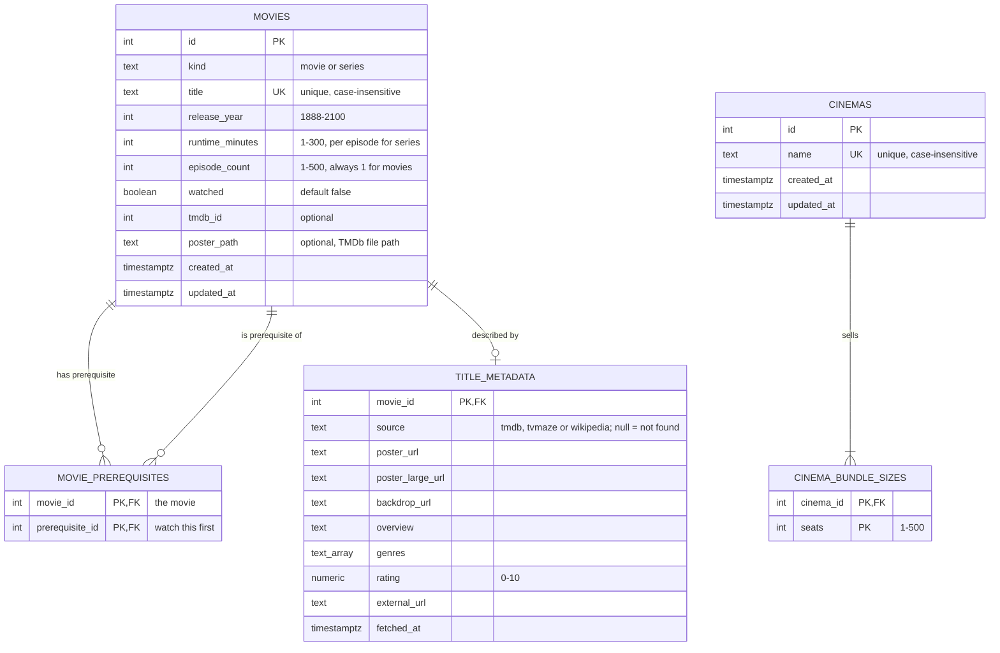

# Doomsday Calling

Plan your MCU rewatch (movies **and** series) before **Avengers: Doomsday**, then book an opening-night watch party.

A full-stack TypeScript app built for the Blinto Talent Accelerator 2027 full-stack internship assessment. It has a React client, an Express API and PostgreSQL. Both core algorithms (dependency ordering with cycle detection, and minimum-bundle booking) are hand-written with no graph or optimisation libraries.



| Rewatch plan                                       | Movies & series                        | Booking                                  | Circular dependency                                                  |
| -------------------------------------------------- | -------------------------------------- | ---------------------------------------- | -------------------------------------------------------------------- |
|  |  |  |  |

## Contents

- [Quick start](#quick-start)
- [Features](#features)
- [How the algorithms work](#how-the-algorithms-work)
- [API reference](#api-reference)
- [Data model](#data-model)
- [Architecture](#architecture)
- [Testing](#testing)
- [Decisions and assumptions](#decisions-and-assumptions)
- [How I used AI](#how-i-used-ai)

## Quick start

### Option A: Docker (one command)

Requires Docker.

```bash
docker compose up --build
```

Open **http://localhost:8080**. The database is migrated and seeded with the brief's sample movies and four cinemas whose bundle sizes match the brief's booking examples.

### Option B: Local development

Requires Node 22+ and Docker (for Postgres only).

```bash
npm install
cp server/.env.example server/.env
npm run db:up        # Postgres on localhost:5433
npm run db:seed      # migrate + load sample data
npm run dev          # API on :4000, client on :5173
```

Open **http://localhost:5173**.

### Posters and details (no setup needed)

Posters, overviews, genres and ratings are found automatically, **without any API key**: [TVMaze](https://www.tvmaze.com/api) for series and [Wikipedia](https://www.mediawiki.org/wiki/API:Main_page) for movies. They are cached in the database, and the server fills in missing titles in the background on startup. Set `METADATA_LOOKUPS=false` to make no external requests.

### Optional: TMDb

With a free [TMDb](https://www.themoviedb.org/settings/api) key you also get movie search with runtime autofill in the add form, and TMDb is used first for movie details (ratings, genres, backdrops). Set `TMDB_API_KEY` (either the v3 API key or the v4 Read Access Token):

- local development: in `server/.env`
- Docker: `TMDB_API_KEY=... docker compose up --build`, or put it in a root `.env` file

### Scripts

| Command                                    | What it does                                       |
| ------------------------------------------ | -------------------------------------------------- |
| `npm run dev`                              | API and client with hot reload                     |
| `npm test`                                 | All server and client tests                        |
| `npm run lint` / `npm run typecheck`       | ESLint / TypeScript across both workspaces         |
| `npm run build`                            | Production builds                                  |
| `npm run db:up` / `db:migrate` / `db:seed` | Start Postgres, apply migrations, load sample data |
| `npm run docker:up`                        | `docker compose up --build`                        |

## Features

### 1. Movies and rewatch order

- Create, list, update and delete movies: title (unique), release year, runtime (1–300 min), prerequisites, watched.
- **Series too.** A title can be a `movie` or a `series` (WandaVision, Loki). Both live in the same catalogue and prerequisite graph, so a movie can require a series and the other way round. For a series, `runtimeMinutes` is the episode length, and its watch time is episodes × runtime.
- Any change that would make a movie depend on itself, directly or through other movies, is rejected with **`409 CIRCULAR_DEPENDENCY`**. The response includes the loop (`Iron Man → Avengers: Endgame → … → Iron Man`), and the UI draws it.
- `GET /api/movies/:id/rewatch-order` returns every movie to watch first, each once and after its own prerequisites. It also returns the watched count and the remaining runtime.

### 2. Cinemas and watch-party booking

- Cinemas sell opening-night seats in 1–10 different bundle sizes of 1–500 seats.
- `GET /api/cinemas/:id/booking?groupSize=N` returns the **fewest bundles** that add up to exactly N seats, or `possible: false`.

### 3. Frontend (React)

| View                | What you can do                                                                                                                                     |
| ------------------- | --------------------------------------------------------------------------------------------------------------------------------------------------- |
| **Movies & series** | Add, edit and delete movies and series; pick prerequisites from a searchable list; tick watched; search and filter by type and status               |
| **Rewatch plan**    | Pick a target and see the ordered list with ticks, an "X of Y watched" progress bar and remaining time. The target is in the URL (`/plan?target=8`) |
| **Booking**         | Pick a cinema and a group size; see the bundles (with a seat strip) or "Not possible". Shareable via `/booking?cinema=3&group=44`                   |

Clicking any title opens its **details page** (`/titles/:id`): poster with a blurred backdrop, overview, genres and rating, what to watch first and what it unlocks next, the watched toggle, edit, and a link to its rewatch plan. Posters also appear in every list.

Ticking watched updates the list, progress bar and remaining time instantly (optimistic update with rollback). Each view has loading, empty and error states. The UI is keyboard and screen-reader friendly, and responsive down to phone widths.

## How the algorithms work

Both live in pure, framework-free modules with their own unit tests.

### Cycle detection ([`dependency-graph.ts`](server/src/modules/movies/dependency-graph.ts))

Prerequisites form a directed graph (`movie → prerequisite`). Giving movie **M** the prerequisite list **P** creates a cycle exactly when **M is reachable from some p in P**. So:

1. Run an iterative depth-first search starting from every movie in P.
2. Ignore M's current edges, because the update replaces them.
3. If the search reaches M, record the path via parent links and reject with 409.

This costs O(V + E). An explicit stack avoids recursion-depth limits; it is tested on a 50,000-movie chain.

### Rewatch order ([`dependency-graph.ts`](server/src/modules/movies/dependency-graph.ts))

This is a **depth-first post-order traversal** from the target. A movie is appended only after all of its prerequisites have been appended, which guarantees every movie comes after what it builds on. A `done` set makes a movie reachable through two paths appear once, and the target itself is never appended. Siblings are explored by release year, then title, so for Avengers: Doomsday the result is exactly the brief's sample order. Cost is O(V + E).

The unit tests include a generic checker: each movie appears once, the set equals the full prerequisite closure, and every edge is respected. It runs on the brief's data and on a random 2,000-node graph.

### Minimum bundles ([`booking-quote.ts`](server/src/modules/cinemas/booking-quote.ts))

This is the **minimum coin change** problem, solved with dynamic programming:

```
best[0] = 0
best[s] = 1 + min(best[s - b])   for every bundle size b ≤ s
```

The bundle that achieved each optimum is stored, so the purchase list is rebuilt by walking back from the group size. Cost is O(groupSize × sizes), at most 100,000 steps under the API limits.

Greedy ("largest bundle first") is wrong here. For sizes 1, 3, 4 and 6 seats it picks 4 + 1 + 1 (three bundles), but 3 + 3 (two) is optimal. The DP is cross-checked against an independent brute-force search on 500 random inputs.

## API reference

All endpoints are under `/api`. Request and response bodies are JSON.

| Method   | Path                                                          | Purpose                                                                |
| -------- | ------------------------------------------------------------- | ---------------------------------------------------------------------- |
| `POST`   | `/movies`                                                     | Create a movie                                                         |
| `GET`    | `/movies`                                                     | List movies (by release year)                                          |
| `GET`    | `/movies/:id`                                                 | Get one movie _(extra)_                                                |
| `PATCH`  | `/movies/:id`                                                 | Update any fields, including `watched` and `prerequisiteIds`           |
| `DELETE` | `/movies/:id`                                                 | Delete a movie _(extra)_                                               |
| `GET`    | `/movies/:id/rewatch-order`                                   | Rewatch order (feature 1)                                              |
| `GET`    | `/movies/:id/details`                                         | Title, prerequisites, titles it unlocks and external details _(extra)_ |
| `POST`   | `/cinemas`                                                    | Create a cinema                                                        |
| `GET`    | `/cinemas`                                                    | List cinemas (by name)                                                 |
| `GET`    | `/cinemas/:id`                                                | Get one cinema _(extra)_                                               |
| `DELETE` | `/cinemas/:id`                                                | Delete a cinema _(extra)_                                              |
| `GET`    | `/cinemas/:id/booking?groupSize=6`                            | Booking quote (feature 2)                                              |
| `GET`    | `/tmdb/status`, `/tmdb/search?query=`, `/tmdb/movies/:tmdbId` | Optional TMDb proxy _(extra)_                                          |
| `GET`    | `/health`                                                     | Health check _(extra)_                                                 |

<details>
<summary>Examples</summary>

```http
POST /api/movies
{ "title": "The Avengers", "releaseYear": 2012, "runtimeMinutes": 143, "prerequisiteIds": [1, 2] }

201 Created
{ "id": 3, "title": "The Avengers", "releaseYear": 2012, "runtimeMinutes": 143, "watched": false,
  "tmdbId": null, "posterPath": null, "prerequisiteIds": [1, 2], "createdAt": "…", "updatedAt": "…" }
```

```http
PATCH /api/movies/1
{ "prerequisiteIds": [7] }

409 Conflict
{ "error": { "code": "CIRCULAR_DEPENDENCY",
  "message": "This would make a movie depend on itself: Iron Man → Avengers: Endgame → Avengers: Infinity War → Captain America: Civil War → The Avengers → Iron Man.",
  "details": { "cycle": [{ "id": 1, "title": "Iron Man" }, { "id": 7, "title": "Avengers: Endgame" }, "…"] } } }
```

```http
GET /api/movies/8/rewatch-order

200 OK
{ "target": { "id": 8, "title": "Avengers: Doomsday", "…": "…" },
  "movies": [{ "id": 1, "title": "Iron Man", "watched": true, "…": "…" }, "… 6 more"],
  "totalCount": 7, "watchedCount": 4, "unwatchedRuntimeMinutes": 477 }
```

```http
GET /api/cinemas/3/booking?groupSize=44

200 OK
{ "cinema": { "id": 3, "name": "Meridian Grand", "bundleSizes": [6, 9, 20] }, "groupSize": 44,
  "possible": true, "totalBundles": 4,
  "bundles": [{ "size": 20, "count": 1 }, { "size": 9, "count": 2 }, { "size": 6, "count": 1 }] }
```

</details>

### Errors

Every error has the shape `{ "error": { "code", "message", "details?" } }`.

| Status | Code                                 | When                                                         |
| ------ | ------------------------------------ | ------------------------------------------------------------ |
| 400    | `VALIDATION_ERROR`                   | Invalid body or query; `details` lists each field            |
| 400    | `UNKNOWN_PREREQUISITE`               | A prerequisite id does not exist                             |
| 404    | `NOT_FOUND`                          | Unknown movie, cinema or route                               |
| 409    | `DUPLICATE_TITLE` / `DUPLICATE_NAME` | Title or name already used (case-insensitive)                |
| 409    | `CIRCULAR_DEPENDENCY`                | The change would create a loop; `details.cycle` has the path |
| 502    | `EXTERNAL_SERVICE_UNAVAILABLE`       | TMDb failed or timed out                                     |
| 503    | `TMDB_NOT_CONFIGURED`                | TMDb lookup used without a key                               |

## Data model



- **`movie_prerequisites`** is a self-referencing many-to-many join table. A `CHECK (movie_id <> prerequisite_id)` blocks direct self-dependency in the database. Indirect cycles are blocked by the API before anything is written.
- **`cinema_bundle_sizes`** has one row per size. Its composite primary key keeps sizes distinct. The 1–10 sizes per cinema rule is enforced by the API.
- **`movies`** holds both movies and series (`kind`). A `CHECK` keeps movies at exactly one episode. Keeping one table means series and movies share one prerequisite graph.
- **`title_metadata`** caches external details, one row per title. "Not found" is cached too, but nothing is cached when every source was unreachable, so outages are retried.
- Deleting a movie or cinema cascades to its rows in the join tables.
- Migrations are plain SQL in [`server/migrations`](server/migrations), applied by a small forward-only runner.

## Architecture

```
.
├── server/                    Express 5 + TypeScript API
│   ├── migrations/            001_create_movies.sql … 005_create_title_metadata.sql
│   ├── src/
│   │   ├── modules/
│   │   │   ├── movies/        dependency-graph.ts (algorithms), schemas, repository, service, routes
│   │   │   ├── cinemas/       booking-quote.ts (algorithm), schemas, repository, service, routes
│   │   │   ├── metadata/      poster and details providers (TMDb, TVMaze, Wikipedia) + cache
│   │   │   └── tmdb/          optional TMDb client + proxy routes
│   │   ├── db/                pool + transactions, migration runner, seed
│   │   ├── middleware/        central error handler
│   │   └── app.ts             builds the app from its dependencies (testable)
│   └── test/                  API integration tests (real Postgres)
├── client/                    React 19 + Vite + TypeScript
│   └── src/
│       ├── api/               fetch wrapper (ApiError), types, TanStack Query hooks
│       ├── components/        layout/ and ui/ (Button, Field, Dialog, ProgressBar, …)
│       ├── features/          movies/, title/, rewatch/, booking/ (one folder per view)
│       └── styles/            design tokens + global styles
├── docker-compose.yml         db → server → client (nginx)
└── .github/workflows/ci.yml   format, lint, typecheck, test, build, Docker build
```

**Server layers.** Routes validate input with zod and call a service. The service owns the business rules and transaction boundaries, and calls a repository that holds all the SQL. The two algorithm files are pure functions with no database or framework imports.

**Raw SQL instead of an ORM.** The schema is small, and explicit SQL keeps constraints, indexes and the locking strategy visible.

**Concurrency.** Writes that change prerequisites run in one transaction behind a Postgres advisory lock. Without it, two simultaneous updates (A requires B, B requires A) could each pass the cycle check alone and still create a cycle together.

**Client.** Server state lives in TanStack Query. Rewatch plans are cached under `['movies', id, 'rewatch-order']`, so any movie change refreshes the list and every plan with one invalidation. Styling uses CSS Modules and design tokens: a dark "premiere night" theme in OKLCH colour, self-hosted fonts and lucide icons.

## Testing

**217 tests**, all run in CI on every pull request against a real Postgres service container.

| Suite              | Count | Covers                                                                                                                                                                                                          |
| ------------------ | ----- | --------------------------------------------------------------------------------------------------------------------------------------------------------------------------------------------------------------- |
| Server unit        | 53    | Cycle detection, rewatch order (including brief examples, random graphs, 50k chains), booking DP (brief examples, greedy counterexample, brute-force cross-check), TMDb client, metadata matching and providers |
| Server integration | 88    | Every endpoint through HTTP against Postgres: validation, uniqueness, the brief's expected results, rollback of rejected updates, series and mixed plans, details endpoint and metadata caching                 |
| Client             | 76    | API error mapping, form validation, optimistic plan updates, timeline, quote rendering, accessibility attributes                                                                                                |

```bash
npm test                          # everything (integration tests need Postgres: npm run db:up)
npm test -w server                # API only
npm test -w client                # UI only
```

Integration tests use a separate `doomsday_test` database, which Docker creates on first start. They are skipped, not failed, if `TEST_DATABASE_URL` is not set.

## Decisions and assumptions

The brief asks for unclear points to be decided and noted. These are mine:

**Movies**

- _"Release year and runtime in minutes: 1–300"_: I read the 1–300 range as applying to runtime. Release year is limited to 1888 (the oldest surviving film) through 2100.
- Titles are trimmed and unique **case-insensitively** ("Iron Man" and "iron man" are the same film).
- Prerequisites are referenced by id. In `PATCH`, `prerequisiteIds` **replaces** the whole list. Duplicate ids are ignored, and unknown ids return `400 UNKNOWN_PREREQUISITE`.
- `POST /movies` creates one movie per request.
- On **create**, a cycle is impossible, because nothing can reference a movie before it exists. The check still runs, so every write path enforces the same rule.
- A rejected `PATCH` changes **nothing**, including other fields in the same request.
- Deleting a movie removes it from other movies' prerequisite lists.

**Series**

- The brief only describes movies. I added series because the MCU story runs through them too. To keep the brief's API intact, they reuse `/api/movies` with a `kind` field that defaults to `movie`, so every request from the brief behaves exactly as specified.
- For a series, the 1–300 runtime rule applies to the episode length, and `episodeCount` (1–500) holds the number of episodes. Remaining watch time counts every episode.
- The sample series (WandaVision, Loki) and Doctor Strange in the Multiverse of Madness all come after Avengers: Endgame, so the brief's expected results (for example 7 titles before Avengers: Doomsday) are unchanged. TMDb autofill is offered for movies only.

**Rewatch order**

- Several orders can be valid. I explore prerequisites by release year, then title, which reproduces the brief's sample order.
- The target is excluded, so its own watched flag does not affect its plan's totals.

**Booking**

- "Not possible" is a valid answer, not an error, so it returns `200` with `possible: false`.
- When several combinations use the same fewest bundles, larger bundles are preferred, so the result is deterministic.
- The 1–10 limit is on _different_ sizes, so duplicates are removed before counting.

**Data**

- Sample movie links come from the brief. Runtimes are theatrical runtimes; Avengers: Doomsday is unreleased, so its 150 minutes is an estimate.
- Sample cinema names are fictional.

**Posters and details**

- External details are display-only. Nothing in the rewatch order or booking logic depends on them, and the details endpoint still answers (with `metadata: null`) when every source is down.
- Wikipedia is matched by title and the article must describe a film or show, so _Iron Man_ the comic character is never used for _Iron Man_ the film. Posters are loaded directly from Wikimedia, TVMaze or TMDb; only those https hosts are accepted.
- Requests send a generic User-Agent with no personal details.

**UI**

- The prerequisite picker does not pre-disable choices that would create a loop. The API is the single source of truth for that rule, and the UI explains its 409 response by drawing the loop.

## How I used AI

The brief allows AI tools if their use is disclosed. I built this project with **Claude Code** (Anthropic's AI coding assistant) as a pair programmer:

- **Direction and decisions were mine:** PostgreSQL as the database, TMDb as an optional (not required) integration, the visual direction, and a professional workflow of one branch and pull request per feature with CI on every PR.
- **The AI wrote most of the code:** the two algorithms, the API, the React views, the tests and this README. It explained each algorithm and decision as it went, and asked before major choices.
- **Verification did not rely on trusting the AI.** Every example from the brief is an automated test, CI runs all 217 tests against a real database, and each view was exercised in a real browser against the real API. When a generated test turned out to prove nothing (a concurrency test that also passed with the lock removed), it was deleted rather than kept as false evidence.
- No library solves features 1 or 2. The graph traversal and the dynamic programming are plain TypeScript in the two files linked above.
